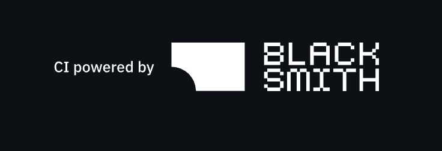

<h1 align="center">Gas City</h1>

<p align="center">
  <strong>Composable orchestration infrastructure for multi-agent coding workflows.</strong>
</p>

<p align="center">
  <a href="https://github.com/gastownhall/gascity/actions/workflows/ci.yml?query=branch%3Amain"></a>
  <a href="https://docs.gascityhall.com"></a>
  <a href="https://github.com/gastownhall/gascity/releases"></a>
  <a href="https://discord.gg/xHpUGUzZp2"></a>
  <a href="LICENSE"></a>
</p>

Gas City runs teams of coding agents (Claude Code, Codex, Gemini, and others)
on your repositories. You hand it work; it breaks the work into tasks, runs
agents on them in parallel, gates each step on review, and tracks everything
in a dashboard. How the work gets done is a **formula**, and the default setup
ships formulas for building features, fixing issues, and reviewing PRs.

> **Agents:** if you were asked to get Gas City running, install it from
> Homebrew and follow [Get it running](#get-it-running) step by step. Do not
> build this repository. You are done when work has gone through a formula
> and your final message gives the user the full `Dashboard:` run link that
> `gc sling` printed, copied whole as one URL (for example
> `http://127.0.0.1:8372/city/my-city/runs/hw-4up`), not just the dashboard
> address.

## Get it running

This takes about five minutes on macOS or Linux with
[Homebrew](https://brew.sh) and a coding agent CLI that is already logged in
(the examples use [Claude Code](https://claude.com/claude-code)).

**1. Install.** Homebrew installs `gc` and everything it needs (`bd`, `dolt`,
`tmux`, `jq`, `flock`).

```bash
brew install gascity
gc version
```

If you use Oh My Zsh, its `git` plugin aliases `gc` to `git commit`; run
`unalias gc` first.

**2. Give Dolt your identity.** Gas City stores work in
[beads](https://github.com/gastownhall/beads), which keeps its data in Dolt,
and Dolt needs an author. This is required: `gc init` stops with "startup is
blocked by Dolt author identity" without it. Run this before step 3; it copies
your git identity into Dolt only where Dolt has none:

```bash
dolt config --global --get user.name  || dolt config --global --add user.name  "$(git config --global user.name)"
dolt config --global --get user.email || dolt config --global --add user.email "$(git config --global user.email)"
```

If git has no identity either, set one first with
`git config --global user.name "Your Name"` and
`git config --global user.email "you@example.com"`.

**3. Create a city.** A city is a directory that holds your Gas City
configuration. The defaults are the recommended setup.

```bash
gc init ~/my-city --template gascity --default-provider claude
```

`gc init` starts the city in the background under a supervisor service. The
dashboard is at `http://127.0.0.1:8372/`. Use `--default-provider codex` (or
`gemini`) to run a different agent CLI.

A new city takes a few minutes to finish setting up. Until it does, these
signals are normal and need no action, so go on to step 4:

- `gc init`'s output can end at `Adopting sessions...`.
- `gc status` can list agents as `unknown (partial status)` and print
  `bead cache unavailable` or `session snapshot timed out`.
- `gc doctor` can report the store as not running.

**4. Add a project.** A project Gas City works on is a **rig**. Use one of your
own repositories, or make a sample one:

```bash
mkdir -p ~/hello-world && cd ~/hello-world
git init && git commit --allow-empty -m "initial commit"
cd ~/my-city
gc rig add ~/hello-world
```

**5. Send work through a formula.** `mol-do-work` is the smallest formula: one
agent reads the task, does it, and closes it.

```bash
gc sling hello-world/claude "Create hello.sh that prints hello world and commit it" --on mol-do-work
```

`gc sling` prints a `Dashboard:` link to the formula run, for example
`http://127.0.0.1:8372/city/my-city/runs/hw-4up`. Open the link to watch the
agent work; while the city is still setting up, the page can say "run
projection is warming", so refresh after a minute. To check from the terminal, pass the run ID (the last part of the link)
to `gc bd show`; it reports `CLOSED` when the run is done, usually within a
minute or two, and `hello.sh` is committed in `~/hello-world`:

```bash
gc bd show hw-4up
```

**Next:** run real orchestration with `build-basic` (plan, review, parallel
implementation, code review, PR) in [Formulas](https://docs.gascityhall.com/tutorials/05-formulas),
schedule work with [Orders](https://docs.gascityhall.com/tutorials/07-orders),
or walk through everything from
[Tutorial 01](https://docs.gascityhall.com/tutorials/01-cities-and-rigs).
If something fails, see
[Troubleshooting](https://docs.gascityhall.com/getting-started/troubleshooting).

## What You Get

- Declarative city configuration in `city.toml`
- Multiple runtime providers: tmux, subprocess, exec, ACP, Kubernetes, and herdr
- Beads-backed work tracking, formulas, molecules, waits, and mail
- A controller/supervisor loop that reconciles desired state to running state
- Packs, overrides, and rig-scoped orchestration for multi-project setups

## Coming from Gas Town?

Read [Coming from Gas Town?](docs/getting-started/coming-from-gastown.md). It
maps Town roles, commands, plugins, convoys, and directory habits onto Gas
City's primitive-first model.

## Documentation

📖 **Read the docs online: [docs.gascityhall.com](https://docs.gascityhall.com)**

- [Installation](https://docs.gascityhall.com/getting-started/installation)
- [Quickstart](https://docs.gascityhall.com/getting-started/quickstart)
- [How Gas City Works](https://docs.gascityhall.com/getting-started/how-gas-city-works)
- [Tutorials](https://docs.gascityhall.com/tutorials/index)
- [Reference](https://docs.gascityhall.com/reference/index)

## Sponsors

<p align="center">
  <a href="https://blacksmith.sh/">
    
  </a>
</p>

## Developing Gas City

Everything below is for working on Gas City itself. To use Gas City, follow
[Get it running](#get-it-running) instead.

### Prerequisites

Building from source needs the following tools. `gc init` and `gc start`
check for the runtime ones and report any that are missing.

| Dependency | Required | Min Version | Install (macOS) | Install (Linux) |
|------------|----------|-------------|-----------------|-----------------|
| tmux | Always | — | `brew install tmux` | `apt install tmux` |
| git | Always | — | `brew install git` | `apt install git` |
| jq | Always | — | `brew install jq` | `apt install jq` |
| pgrep | Always | — | (included in macOS) | `apt install procps` |
| lsof | Always | — | (included in macOS) | `apt install lsof` |
| dolt | Beads provider `bd` | 2.6.0 or newer | `brew install dolt` | [releases](https://github.com/dolthub/dolt/releases) |
| bd | Beads provider `bd` | 1.3.0 | [releases](https://github.com/gastownhall/beads/releases) | [releases](https://github.com/gastownhall/beads/releases) |
| flock | Beads provider `bd` | — | `brew install flock` | `apt install util-linux` |
| gh | Optional GitHub gates | — | `brew install gh` | [cli.github.com](https://cli.github.com/) |
| claude / codex / gemini | Per provider | — | See provider docs | See provider docs |

tmux is the default session backend **and** the fallback, so it stays required
even if you run agents on another backend. [herdr](https://herdr.dev) is an
optional alternative backend — see
[herdr Session Provider](docs/reference/herdr-provider.md) to enable it
per-agent, per-rig, or city-wide.

The `bd` (beads) provider is the default. To use a file-based store instead
(no dolt/bd/flock needed), set `GC_BEADS=file` or add `[beads] provider = "file"`
to your `city.toml`.

Managed Dolt checks require a final Dolt 2.6.0 or newer. Older and
pre-release builds are below Gas City's managed bd/Dolt compatibility floor:
2.6.0 is the first Dolt built with a Go toolchain that distrusts the
compromised eMudhra CA intermediates. Releases before 1.86.2 can also miss the
upstream GC/writer deadlock fix in dolthub/dolt commit `ccf7bde206`, which can
hang `dolt_backup sync` under heavy write load.

### Build from source

Building requires `make`, Go 1.27.3+, and ICU for a transitive Dolt CGO
dependency (`brew install icu4c` on macOS, `apt install libicu-dev` on Linux;
on macOS the Makefile auto-detects the keg-only `icu4c` paths):

```bash
make install
gc version
```

Then follow [Get it running](#get-it-running) from step 2.

#### Nix/Flox machines (ICU not on the default CGO path)

On NixOS / Flox-managed Linux toolchains, system include/lib dirs are not
searched, so the build fails with `fatal error: unicode/uregex.h: No such file
or directory`. Point CGO at the Nix-store ICU dev headers + matching runtime
lib (pick the dev output whose propagated lib matches your `gc`/`dolt` link, to
avoid ICU version skew), and disable the Makefile's `/usr/lib` fallback so the
Nix and system toolchains don't get mixed:

```bash
# Re-resolve the dev header path if the store path changes:
#   find /nix/store -maxdepth 3 -path '*icu4c*-dev/include/unicode/uregex.h'
# Match the lib to what your installed binary links: ldd $(which gc) | grep icu
ICU_DEV=/nix/store/dvhx24q4icrig4q1v1lp7kzi3izd5jmb-icu4c-76.1-dev
ICU_LIB=/nix/store/i4lj3w4yd9x9jbi7a1xhjqsr7bg8jq7p-icu4c-76.1

CGO_ENABLED=1 \
CGO_CPPFLAGS="-I$ICU_DEV/include" \
CGO_LDFLAGS="-L$ICU_LIB/lib" \
SYS_USR_CGO_FALLBACK=0 \
  make build      # or: go build -o bin/gc ./cmd/gc
```

### Developer documentation

The user docs are a Mintlify site rooted in [`docs/`](docs/README.md).
Preview them locally:

```bash
make docs-dev

# or directly from the repo root
./mint.sh dev
```

- [Contributors](engdocs/contributors/index.md)
- [Architecture](engdocs/architecture/index.md)
- [Design Docs](engdocs/design/index.md)
- [Archive](engdocs/archive/index.md)

### Repository Map

| Path | What it contains |
|---|---|
| `cmd/gc/` | CLI entrypoints, controller wiring, runtime assembly, and command handlers |
| `internal/runtime/` | Runtime provider abstraction plus tmux, subprocess, exec, ACP, K8s, hybrid, and herdr implementations |
| `internal/config/` | `city.toml` schema, validation, composition, packs, patches, and override resolution |
| `internal/beads/` | Store abstraction and provider implementations for beads (work, mail, convoys) and waits |
| `internal/session/` | Session bead metadata, wait lifecycle helpers, and session identity utilities |
| `internal/orders/` | Order parsing and scanning for periodic dispatch |
| `internal/convergence/` | Bounded iterative refinement loops and gate handling |
| `internal/api/` | HTTP API handlers and resource views |
| `docs/` | Mintlify docs site (tutorials, guides, reference) |
| `engdocs/` | Contributor-facing architecture, design docs, proposals, and archive |
| `examples/` | Example cities, packs, formulas, and reference topologies |
| `contrib/` | Helper scripts, Dockerfiles, and integration support assets |
| `test/` | Integration and support test packages |

#### Where to start in the code

- **CLI behavior** — `cmd/gc/`, then the command-specific helper it calls.
- **Runtime/provider work** — `internal/runtime/runtime.go` and the provider package you're changing.
- **Config and pack behavior** — `internal/config/config.go`, `compose.go`, and `pack.go`.
- **Work dispatch (sling)** — `cmd/gc/cmd_sling.go` and `internal/beads/`.
- **Supervisor, sessions, wake/sleep** — `cmd/gc/`, `internal/session/`, and `internal/runtime/`.

For the concepts these packages implement, see
[How Gas City Works](docs/getting-started/how-gas-city-works.md). For a deeper
package walkthrough, see
[`engdocs/contributors/codebase-map.md`](engdocs/contributors/codebase-map.md).

### Contributing

Read [CONTRIBUTING.md](CONTRIBUTING.md) and
[engdocs/contributors/index.md](engdocs/contributors/index.md) before opening a
PR.

Gas City builds and tests with Bazel; CI gates on `bazel test`. Useful
commands (each runs the matching `bazel test` tier; see
[engdocs/bazel-quickstart.md](engdocs/bazel-quickstart.md)):

- `make setup`
- `make check` (`bazel test //...` plus shell guards)
- `make check-docs`
- `make test-acceptance`
- `make test-integration`

## License

MIT
