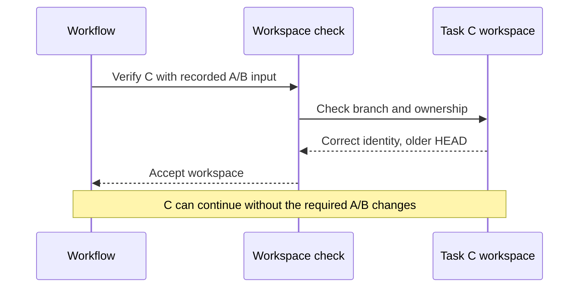
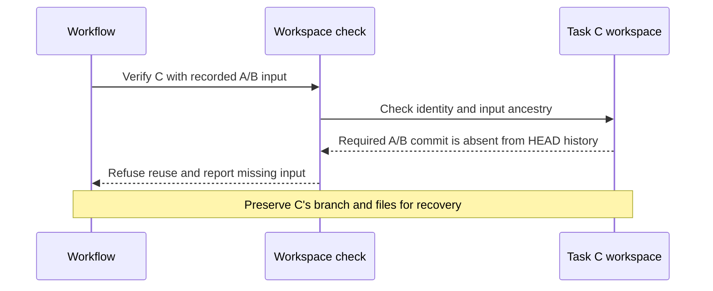

Dependent tasks need the output of their prerequisites in their starting
history. A leftover workspace may have the right branch name and ownership
record but still be missing that input after a branch reset.

`gc worktree ensure` and `gc worktree verify` check that a managed workspace's
current commit contains its required input commit. Extra commits above that
input remain usable. A workspace missing the input is refused, with its branch
and working files preserved.

## Before and after

These diagrams apply to callers of `gc worktree ensure` or `gc worktree verify`.
A workflow that runs `git worktree add` directly does not receive this guard.

In this example, the workflow has selected the combined A/B commit as C's
required input, but C's branch has been reset behind it.

Before the ancestry check:



With the ancestry check:



When C's history contains the required input, verification succeeds and
retains C's additional commits. This proves ancestry only. The workflow must
select accepted predecessor outputs, integrate them into an exact input commit,
and validate the resulting behavior before giving that output to D.

## Supply the input for a dependent task

For example, tasks A and B finish independent changes. Integrate their outputs
in the repository, then supply that combined commit as task C's base. When D
depends on C, supply C's resulting commit as D's base.

Use a distinct workspace and branch for each task. Replace these example paths,
commit and ownership values with the ones selected by your workflow:

```bash
repo=/path/to/rig
root=/path/to/workspaces
input_commit=REPLACE_WITH_COMBINED_A_AND_B_COMMIT_SHA

gc worktree ensure \
  --repo "$repo" --root "$root" --path "$root/task-c" \
  --branch work/task-c --base "$input_commit" \
  --bead task-c --store-ref city:example \
  --creator workflow --owner workspace-provisioner \
  --generation attempt-1 --lifecycle active --json
```

The base must resolve to a commit in the local repository. `--base-sha` can
also pin the resolved commit when reusing a workspace. A same-named tag does
not change which local branch is checked for reuse.

To inspect an existing workspace, use `gc worktree verify` with the same
identity and base flags. To plan creation or reuse without changing anything,
add `--dry-run` to `gc worktree ensure`. Dry-run planning applies the same
required-input check and can refuse a stale branch before creating a directory.

## Recover when the required input is missing

A refusal such as `HEAD ... does not contain recorded base ...` means the
branch's history no longer contains the input recorded for the workspace.
An existing branch without a workspace can also be refused when it lacks the
supplied base.

1. Inspect the branch and preserve any committed and uncommitted work. A refusal
   does not reset, rebase, delete or overwrite the workspace.
2. Use `gc worktree ensure` to create a fresh workspace path and branch based
   on the required input, or deliberately integrate that input into the
   existing branch after reviewing its changes.
3. Run `gc worktree verify` with the selected workspace's matching path,
   branch, ownership and required input before continuing dependent work.

The check validates the supplied or recorded input. It does not automatically
find newer prerequisite outputs, merge them, or rewrite the ownership record.
When inputs change, the workflow must select the new base and a compatible
workspace explicitly.

## Keep workflow and acceptance checks separate

- **Worktree:** verify that this checkout descends from the recorded input.
- **Workflow:** select accepted predecessor outputs, integrate them, and pass
  the exact result to the dependent task through the native worktree commands.
- **Acceptance:** run project tests, requirement-specific checks and independent
  review against the exact integrated commit. A subsequent commit invalidates
  that evidence; ancestry alone does not show that behavior survived.

Closing a work record is warning-only by default. Its commit and outcome
metadata do not establish functional correctness. Workflow checks must enforce
acceptance explicitly.

See the [worktree CLI reference](/reference/cli#gc-worktree) for the complete
flag set and cleanup safety checks.
