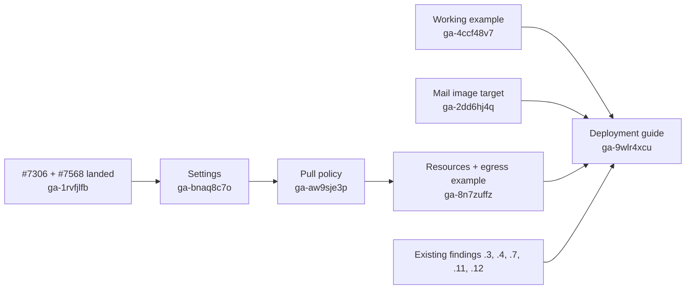

# Kubernetes quick fixes

Root: ga-0rxe5040. PM planning date: 2026-11-27.
Plan branch: `docs/ga-0rxe5040-k8s-quick-fixes`.
Source snapshot: `6dce31bbb68e31a95482815050a0ace951be47ce`.
This snapshot grounds the findings; each build and deploy pins its own current base.

## Outcome and priority

An operator can select Kubernetes settings in TOML, start a kind-loaded agent
image, initialize a working example, build the mail image, and specify resources
for a quota-constrained namespace. A verified deployment guide then explains the
supported path.

The operator's latest instruction allows Kubernetes to start wherever Windows
is not blocking; Windows retains highest priority. The root's former Windows
blocking edges were removed upstream. This plan introduces none.

Each of the six work scopes below produces one focused PR. Test-first scopes
use one bead through validator and builder; there is no second implementation
bead for the same scope. No UX design or new architecture decision is required.

## Existing evidence and ownership

The real kind-on-rootless-podman baseline is ga-61pa5gih. Its durable evidence is:

- `/home/jaword/projects/gc-management/.gc/artifacts/gascity/ga-61pa5gih/FINDINGS.md`
- `/home/jaword/projects/gc-management/.gc/artifacts/gascity/ga-61pa5gih/k8s-kind-harness.sh`

The investigator closed smoke beads from a host-orchestrated city with documented
workarounds. That establishes a baseline, not that the shipped example already
works. The in-cluster and split-storage paths have separate unresolved defects.

Mayor owns the contributor stack under gm-oq61pu.3. Preserve chris-sanders'
existing PRs and attribution:

| PR | Existing scope | Impact on this plan |
| --- | --- | --- |
| [#7306](https://github.com/gastownhall/gascity/pull/7306) | Secret projection; native/hybrid provider construction | Extend its wiring after landing |
| [#7568](https://github.com/gastownhall/gascity/pull/7568) | Numeric non-root identities and pod security | Preserve its settings and example changes |
| [#8158](https://github.com/gastownhall/gascity/pull/8158) | Canonical hosted ledger identity | Do not duplicate pod-init/identity repair |
| [#8160](https://github.com/gastownhall/gascity/pull/8160) | Startup dialogs | Re-check before asserting rig-scoped smoke |
| [#8203](https://github.com/gastownhall/gascity/pull/8203) | Codex in the agent image | Leave this image work with its contributor |
| [#8229](https://github.com/gastownhall/gascity/pull/8229) | Identity during runtime reuse | Preserve lifecycle behavior |
| [#8269](https://github.com/gastownhall/gascity/pull/8269) | Rig binding projection | Re-check before claiming rig support |
| [#8645](https://github.com/gastownhall/gascity/pull/8645) | Pod-local worker commands | Preserve the existing stack sequence |

At intake, #7306 and #7568 were both OPEN with no merge commit. A closed
conflict-resolution bead is not evidence that either landed: ga-b5dn345o closed
with `gc.work_outcome=blocked`, and its review ga-6hwwo7r7 closed `no-op`.
Same-store record **ga-1rvfjlfb** remains open until both contributor PRs reach
main. Mayor owns landing coordination; this record is unrouted and is not work
to sling.

Tracker import was a no-op: no sibling jira, linear, github-issues, tracker-*
skill or tracker-to-beads skill is installed in this PM worktree. The supplied
root, investigation, and existing GitHub issue/PR records supplied intake; no
tracker manifest was created.

## Work packages

All six work beads have `source:actual-pm`, `k8s`, priority 2, and a
`discovered-from:ga-0rxe5040` edge. These origin edges form the plan's tree;
they are not parent-child closure gates. Full acceptance criteria are in each
bead's notes.

| Bead | User outcome | Intake label / intended target | Depends on |
| --- | --- | --- | --- |
| ga-bnaq8c7o | Namespace, image, context and prebaked TOML settings reach native/hybrid providers | needs-tests / validator | ga-1rvfjlfb |
| ga-aw9sje3p | Configurable agent pull policy defaults to IfNotPresent | needs-tests / validator | ga-bnaq8c7o |
| ga-4ccf48v7 | Shipped example uses valid keys and resolves at least one agent | ready-to-build / builder | Independent |
| ga-2dd6hj4q | Discoverable Makefile target builds gc-mcp-mail:latest | ready-to-build / builder | Independent |
| ga-8n7zuffz | TOML resource requests/limits and optional example egress policy | needs-tests / validator | ga-aw9sje3p |
| ga-9wlr4xcu | Verified Kubernetes guide addressing issue #816 | ready-to-build / builder | Examples, mail image, resources, and five existing findings below |

### Settings: ga-bnaq8c7o

Observe effective provider/pod settings, not only TOML decoding. Exercise native
and hybrid construction, each environment override, absent-source defaults,
prebaked true/false and per-city isolation. Preserve the contributor Secret and
numeric-identity configuration. This scope deliberately excludes the four
resource fields, which belong only to ga-8n7zuffz.

### Pull policy: ga-aw9sje3p

Cover the default and all Kubernetes policy choices, TOML/env precedence,
invalid-policy errors before pod creation, and staged/prebaked agent paths.
Demonstrate a kind-loaded agent image starting without the external-registry
workaround. Helper image policy is a separate concern.

### Example: ga-4ccf48v7

Remove unsupported workspace.isolation, use install_agent_hooks, and wire the
shipped agents through supported config composition. Verify a real scratch-city
read resolves at least one intended agent and valid provider, with working
relative paths. Preserve contributor non-root settings when they land. No new
loader feature is required.

### Mail image: ga-2dd6hj4q

Follow existing Makefile help, PHONY and container-tool conventions. Verify the
command and tag by dry run and a real image build; document existing kind loading
steps. The non-numeric mail image USER launch bug remains ga-61pa5gih.7; a new
build target does not claim to fix it. Do not publish images or touch the live
city.

### Resources and policy: ga-8n7zuffz

Cover all four existing TOML resource fields, independent environment overrides,
documented defaults and contextual errors for invalid quantities. Record an
admitted pod's effective resources in a namespace with ResourceQuota. Validate
the optional policy with an allowed smoke and a denied unlisted destination;
document required DNS, ledger/mail and selected external-provider destinations.
Keep this configuration under the existing provider contract.

### Deployment guide: ga-9wlr4xcu

Address [issue #816](https://github.com/gastownhall/gascity/issues/816): persistent
versus ephemeral state, image construction, staged/prebaked use, credentials,
Dolt identity/endpoint, restart behavior, dashboard access, routing, mail/MCP and
a reproducible kind quickstart. Add navigation and Guides overview links. Follow
the gascity-docs skill; generated references are edited at their source.

The runnable guide depends on existing findings ga-61pa5gih.3 (pod init),
ga-61pa5gih.4 (environment projection), ga-61pa5gih.7 (manifests),
ga-61pa5gih.11 (fresh-ledger identity), and ga-61pa5gih.12 (credential sync).
Verify the repairs have landed before claiming the quickstart works. The guide
may explicitly select the supported single-store host-orchestrated mode.
ga-61pa5gih.5 (in-cluster) and ga-61pa5gih.15 (split-storage/CN-2) are limitations,
not scheduling blockers on that documented mode. No blanket production or
rig-scoped claim follows from the host-city smoke.

## Dependency graph

All blocking edges are within the gascity store. `A -> B` means B waits for A.

The settings/pull/resources chain serializes edits to shared provider/config
construction. The example and mail build scopes can proceed independently.
No blocking edge points at a merely closed contributor build/review record.

## Verification and handoff

Validator authors failing coverage and passes the same needs-tests bead to
builder. Builder owns example/build-target/guide repair without a separate
test-first bead. Each implementation records its real base, exact commands,
named test results, artifact evidence and remaining workarounds. Tests run
through Bazel, with make bazel-sync after adding files/imports.

Complexity must show **zero growth against the pinned base**. A feature never
edits engdocs/complexity-baseline.json. Apply the full complexity-zero-growth
fragment: a green base requires a green canonical-merge check; a red base
requires base/merge check output with no worse row and a measured complexity
diff with no new/regressed row or deleted function that still exists.

The PM plan is committed, checked clean and pushed on its own branch before
closing the planning root. Sling each work bead with --nudge, then read the
route/label and run ready-visibility. Handoff receipts in the root notes report
admission, route, claimability and held state separately, with times. Intended
targets in this artifact do not assert that a bead has been admitted or queued.
Mail one verified summary per distinct target and a landing/blocker summary
to mayor. Never sling ga-1rvfjlfb.

## Risks and limits

- Existing contributor and launch repairs can hold the provider chain or guide;
  that dependency is deliberate and must not be bypassed by duplicate fixes.
- Environment-only resource handling already exists. The settings/resource
  scope boundary prevents two beads from implementing it twice.
- A buildable mail image can still fail its manifest's security policy; report
  that as the existing finding.
- Quick fixes do not supply the broader RFC #9522 architecture, worker-site
  transport, performance redesign or OpenChoreo integration.

